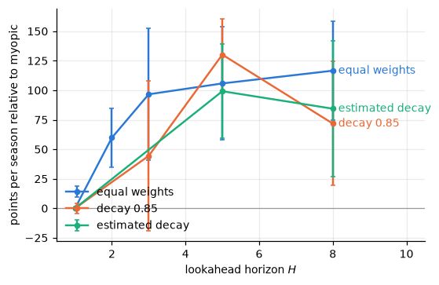
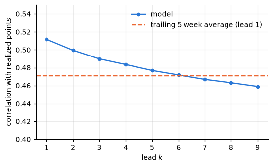
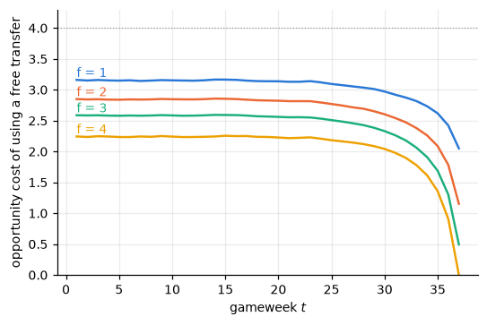

# fpl-mdp

In Fantasy Premier League you pick a 15-player squad, a starting eleven and a captain each week, and make transfers under a budget, scoring points from what the players actually do. This project asks how much of a score comes from planning ahead versus from knowing the results.

## Results

- planning 3 to 5 weeks ahead beat planning one week by ~100 pts a season
- the same strategies beat the average real manager by ~160 pts a season
- a banked free transfer came out worth 1.7 to 2.7 pts at gameweek 10 (less the more are banked), against a 4-point hit, solving the banking game on the 185 real weekly menus from the backtest, sorted to be decreasing
- perfect foresight (knowing every result in advance) would add about 2650 to 2950 pts a season over `h5b`

The hindsight run uses a more permissive selling rule (it keeps the full profit on price rises, not half), so the gap overstates the value of foresight alone; it also scores only the XI and captain, with no auto-subs.



*Points per season relative to one-week planning, by lookahead horizon, under three weighting schemes. Bars are standard errors over five seasons.*

## Run

Data is from [vaastav/Fantasy-Premier-League](https://github.com/vaastav/Fantasy-Premier-League), seasons 2020-21 to 2025-26 into `data/raw/<season>/`; `data.get_snap(season)` grabs the average manager scores.

```
uv sync
python model.py
```

builds the forecast caches in `data/cache/`, then run the notebooks. The backtest caches don't have a single script yet (todo).

## How it works

**Team goals.** Poisson with $\log \lambda = \mu + \text{home} + \text{attack} - \text{defence}_{\text{opp}}$, fitted each gameweek on past matches only by weighted maximum likelihood with a ridge penalty (0.3), which pins down the attack and defence levels, since adding a constant to every attack and every defence leaves every $\lambda$ unchanged. Matches are weighted by exponential decay at 0.03 per gameweek, and last season's matches are additionally weighted 0.5.

**Players.** Each team goal goes to player $i$ with probability $p_i$ (goals per 90, or expected goals per 90 from 2022-23, times expected minutes, normalized), so by thinning player $i$ scores $\text{Poisson}(\lambda p_i)$. Assists are split the same way at 0.8 per goal. Minutes have three states (0, 1 to 59, 60+). Clean sheet probability is $e^{-\lambda'}$ and the conceded penalty is $\mathbb{E}\lfloor N'/2 \rfloor$ for $N' \sim \text{Poisson}(\lambda')$, $\lambda'$ the opponent's rate.

**Expected points.** The scoring weights times these expectations, plus saves, bonus, yellow cards and defensive contributions.



*Correlation between forecast and realized points, by how many weeks ahead the forecast was made.*

**Banking game.** State is $f \in \{1, \dots, 5\}$ banked free transfers. Each week the best $u$ transfers gain $G(u)$, each transfer past $f$ costs 4, and next week's stock is $n(f, u) = \min(\max(f - u + 1, 1), 5)$. Backward induction:

$$V_t(f) = \mathbb{E}\Big[\max_u \big\{ G(u) - 4(u-f)^+ + V_{t+1}(n(f, u)) \big\}\Big], \qquad V_{39} = 0.$$



*Value of a banked free transfer by stock and gameweek, under a synthetic menu distribution (exponential gains, mean 2) that is not calibrated to the real menus.*

**Squad selection.** Integer program for squad, lineup, captain and transfers over the next $H$ weeks, maximizing forecast points minus 4 per hit, solved with PuLP/CBC. Each week the first week of the plan is applied and the plan is recomputed.

## Backtest

Five seasons, 2021-22 to 2025-26, each with its own rules.

| season | freeze | h1 | h2 | h3 | h5 | h8 | h3d | h5d | h8d | h5b | h8b |
|---|---|---|---|---|---|---|---|---|---|---|---|
| 2021-22 | 2135 | 2154 | 2147 | 2175 | 2242 | 2312 | 2159 | 2203 | 2127 | 2216 | 2211 |
| 2022-23 | 1595 | 2069 | 2181 | 2175 | 2118 | 2154 | 1997 | 2214 | 2050 | 2133 | 2070 |
| 2023-24 | 2023 | 2142 | 2159 | 2074 | 2115 | 2123 | 2078 | 2226 | 2186 | 2131 | 2083 |
| 2024-25 | 1801 | 1972 | 2033 | 2224 | 2221 | 2205 | 2244 | 2197 | 2233 | 2177 | 2239 |
| 2025-26 | 1276 | 1827 | 1943 | 1999 | 1997 | 1953 | 1908 | 1975 | 1927 | 2003 | 1983 |
| vs. h1, mean | −267 | | +60 | +97 | +106 | +117 | +44 | +130 | +72 | +99 | +84 |
| standard error | 104 | | 25 | 56 | 48 | 42 | 63 | 30 | 53 | 40 | 58 |

*Season points by strategy: `hK` plans K weeks ahead with equal weights, `d` weights week k by $0.85^{k-1}$, `b` by the estimated forecast slopes, `freeze` never transfers after week 1.*

| season | average manager | h1 | h3 | h5b |
|---|---|---|---|---|
| 2021-22 | 1923 | 2154 | 2175 | 2216 |
| 2022-23 | 2026 | 2069 | 2175 | 2133 |
| 2023-24 | 2003 | 2142 | 2074 | 2131 |
| 2024-25 | 2008 | 1972 | 2224 | 2177 |
| 2025-26 | 1895 | 1827 | 1999 | 2003 |
| vs. average, mean | | +62 | +158 | +161 |
| standard error | | 55 | 34 | 35 |

*Season points of the average real manager (sum of the game's per-gameweek averages) and of three strategies.*

Planning ahead beats the one-week strategy by about 100 points a season, but five seasons can't tell the planning variants apart. Longer plans take fewer hits (7.0 per season for `h1`, 2.0 for `h8`). The one-week strategy is about average, and every planning strategy beats the average manager in every season except `h3d` in 2022-23, `h5b` by 107 to 293.

## Limitations

- chips (wildcard, bench boost, triple captain) are implemented but unused in the backtest; the free hit and price changes are not modelled
- no injury data, so availability is inferred from past minutes
- the average manager benchmark includes abandoned teams

## Files

- `data.py` loads a season, per-season rules, average manager scores
- `model.py` team goal model, player forecasts, gameweek simulator
- `milp.py` weekly squad integer program
- `sim.py` runs a strategy through a season, hindsight runs
- `bank.py` banking game by backward induction
- `notebooks/` calibration, backtest and banking plots (figures in `figs/`)

Math notes in `docs/math.md`.
